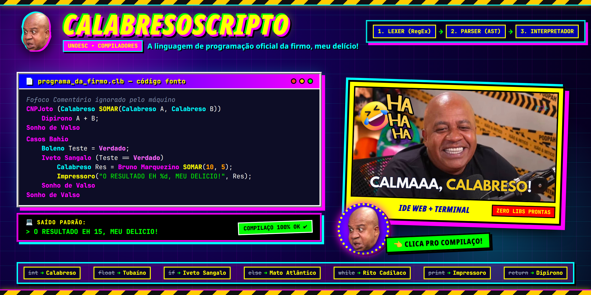

# CalabresoScripto

<p align="center">
  
</p>

> **Universidade do Oeste de Santa Catarina (UNOESC) - Campus Videira**  
> **Disciplina:** Compiladores  

<table>
  <tr>
    <td align="center">
      <br />
      <sub><b>Kauã Camargo</b></sub>
    </td>
    <td align="center">
      <br />
      <sub><b>Wesllen da Cruz</b></sub>
    </td>
    <td align="center">
      <br />
      <sub><b>Samuel De Lorenzi</b></sub>
    </td>
  </tr>
</table>

---

## 🛠️ Arquitetura do Projeto

A linguagem não utiliza bibliotecas de parsing prontas, sendo construída através das três etapas clássicas:

1. **Analisador Léxico (`lexer.py`)**: Responsável por ler o código fonte e convertê-lo em uma lista de *Tokens* utilizando Expressões Regulares (RegEx).
2. **Analisador Sintático (`parser_clb.py`)**: Recebe os tokens e constrói a Árvore Sintática Abstrata, validando as regras gramaticais da linguagem.
3. **Interpretador (`interpreter.py`)**: Mapeia a AST, avaliando expressões, executando declarações e gerenciando o escopo de variáveis e funções em tempo de execução.

## 📖 Sintaxe da Linguagem

Abaixo está o mapeamento das palavras reservadas da linguagem em comparação com as estruturas convencionais de programação:

### Estrutura e Tipos
| Convencional | CalabresoScripto |
| :--- | :--- |
| `Start` | `Casos Bahio` |
| `End Block` | `Sonho de Valso` |
| `int` | `Calabreso` |
| `float` | `Tubaíno` |
| `long` | `Mussarelo` |
| `double` | `Salsicho` |
| `char` | `Madono` |
| `boolean` | `Boleno` (`Verdado` / `Mentiro`) |

### Controle de Fluxo
| Convencional | CalabresoScripto |
| :--- | :--- |
| `if` | `Iveto Sangalo` |
| `else if` | `Patrício Poeto` |
| `else` | `Mato Atlântico` |
| `for` | `Cinderelo` |
| `while` | `Rito Cadilaco` |
| `break` | `Borboleto` |
| `continue` | `Tilápio` |

### I/O e Funções
| Convencional | CalabresoScripto |
| :--- | :--- |
| `print()` | `Impressoro` |
| `input()` | `Samsungo` |
| `def` (Definir Função) | `CNPJoto` |
| `call()` (Chamar Função) | `Bruno Marquezino` |
| `return` | `Dipirono` |

## 🚀 Como Executar

O projeto pode ser executado de duas maneiras: via Terminal ou através da Web.

### 1. Via Interface Web
Para iniciá-lo, basta rodar:

```bash
python server.py
```
Após isso, acesse `http://localhost:8000` no seu navegador.

A interface (pasta `web/`) imita o Windows 98: janelas arrastáveis, editor com destaque de sintaxe, Prompt do MS-DOS para a saída e o assistente Toninho Tornado. Atalhos: `F5` ou `Ctrl+Enter` executa, `Ctrl+S` salva o `.clb` e `Ctrl+O` abre um arquivo.

### 2. Via Terminal
Para rodar scripts diretamente pelo terminal, crie um arquivo de texto com a extensão `.clb` e passe-o como argumento para o analisador:

```bash
python lexer.py seu_arquivo.clb
```
